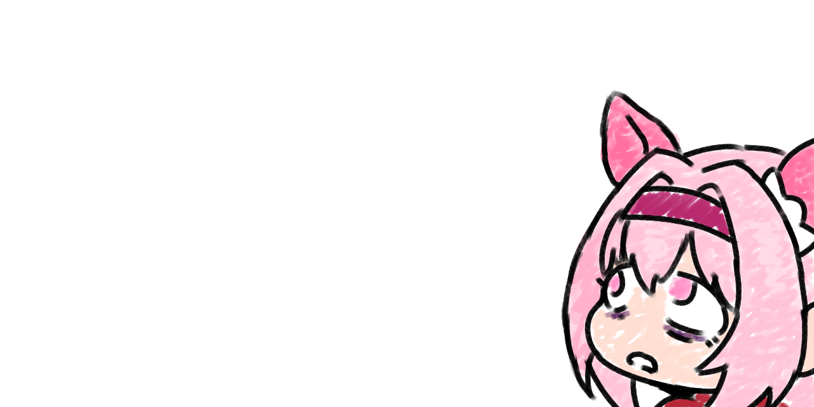

# hey, i'm maple

full stack dev · artist · cloud nerd — i break things and sometimes fix them

---

## stuff i actually ship

- **[umamusume_apworld](https://github.com/maplehugs/umamusume_apworld)** — archipelago multiworld randomizer for umamusume. yes, the horse girl game. no, i'm not sorry
- **[PD2-Criminal-Dawn](https://github.com/maplehugs/PD2-Criminal-Dawn)** — payday 2 turned into a multiworld roguelite via archipelago.gg
- **[SkinShare_Gmod](https://github.com/maplehugs/SkinShare_Gmod)** — gmod addon: share your workshop playermodel with the whole server mid-game, no restart
- **[ai_transcription](https://github.com/maplehugs/ai_transcription)** — whisper + nemo transcription web app that tells apart who said what
- **[neural-network-austral](https://github.com/maplehugs/neural-network-austral)** — GRU stockout forecasting with monte carlo sims, the one serious repo here

## stack

- **languages** — java, c#, python, javascript, lua, kotlin, bash *(the ones i mass produce bugs in)*
- **backend** — spring, flask, next.js, mysql/mariadb, sqlite, supabase
- **ml** — pytorch, tensorflow/keras *(they will control us one day)*
- **elsewhere** — gcp, oci, cloudflare *(may or may not have debts with some of these)*, ghidra, krita

